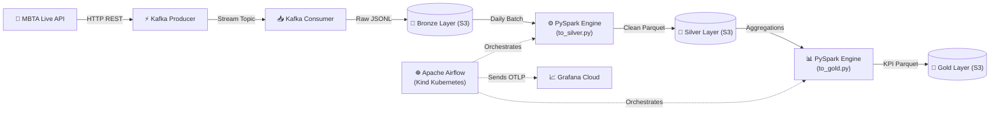
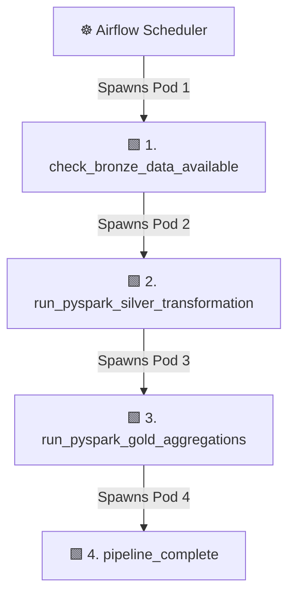

# Cloud Transit Lakehouse Pipeline
## Real-Time & Batch Data Engineering Project
**Author:** Subhadip Khawas  
**Architecture:** Kafka ➔ PySpark ➔ Amazon S3 ➔ Apache Airflow on Kubernetes

---

## Slide 1: Executive Summary & Project Goal

### 🎯 The Problem
City buses and trains generate thousands of position updates every second. 
- How do we capture live GPS data without losing records?
- How do we clean and store data cheaply at cloud scale?
- How do we automate daily business KPIs (bus delays & speed bottlenecks) reliably?

### 💡 The Solution
A **Modern Medallion Transit Lakehouse**:
- **Streaming:** Ingests live MBTA transit data via **Apache Kafka**.
- **Processing:** Transforms raw JSON into query-ready Parquet with **PySpark**.
- **Storage:** Stores layered data on **Amazon S3** (Sydney `ap-southeast-2`).
- **Orchestration:** Scheduled and monitored with **Apache Airflow on Kubernetes**.
- **Observability:** Centralized metrics and logs with **OpenTelemetry & Grafana Cloud**.

---

## Slide 2: End-to-End Architecture

---

## Slide 3: The Medallion Lakehouse Pattern

Why divide data into three layers?

| Layer | Format | What it contains | Why we need it |
| :--- | :--- | :--- | :--- |
| **🥉 Bronze** | Raw `.jsonl` | Exact copy of incoming public API data | Disaster recovery & zero data loss |
| **🥈 Silver** | `.parquet` (Snappy) | Cleaned, deduplicated, standardized schema | Fast querying & schema enforcement |
| **🥇 Gold** | `.parquet` (Snappy) | Business KPIs (Route speeds & traffic bottlenecks) | Ready for executive reports & dashboards |

---

## Slide 4: Key Business Metrics Produced (Gold Layer)

The pipeline automatically computes two critical transit metrics:

### 1. Route Performance Metrics
- **Average vehicle speed** per route ID.
- **Total active vehicles** operating at peak vs off-peak hours.
- **Status distribution** (In transit, stopped at station, incoming).

### 2. Congestion & Delay Hotspots
- Top 10 slowest stops where transit vehicles face highest latency.
- Helps transit planners identify where dedicated bus lanes are needed.

---

## Slide 5: Kubernetes-Native Orchestration (Airflow)

We deployed Airflow using **KubernetesExecutor** inside **GitHub Codespaces & Kind**:

### Why KubernetesExecutor is Enterprise-Grade:
- **Zero Resource Waste:** Pods are created on-demand and deleted when done.
- **Total Isolation:** PySpark memory bottlenecks in one task never crash the rest of Airflow.
- **Reproducibility:** Runs identically on a local developer laptop and in GitHub Codespaces.

---

## Slide 6: Cloud Security & Best Practices Implemented

1. **Least-Privilege AWS IAM**:
   - Explicit region binding (`ap-southeast-2`) compliant with organization Service Control Policies (SCPs).
2. **Zero-Secret Codebase**:
   - All credentials managed via Kubernetes Secrets (`cde-aws-secrets`) and `.env` files.
   - Pushes protected by GitHub Secret Scanning.
3. **Automated CI/CD**:
   - Push to `main` triggers GitHub Actions to build and publish the container image to **GitHub Container Registry (`ghcr.io`)**.

---

## Slide 7: Project Key Results & Verification

- **Lakehouse Storage:** Verified live multi-date partitions in **Amazon S3 Sydney**.
- **PySpark Speed:** Silver & Gold transformations execute in **< 30 seconds**.
- **Pipeline Health:** All 4 pipeline stages passed with **100% green status**.
- **Live Observability:** OpenTelemetry endpoint verified with **HTTP 200** to Grafana Cloud.

---

## Slide 8: Next Steps & Future Enhancements

1. **Dashboard Visualization**: Connect Streamlit / Grafana to query the S3 Gold tables via DuckDB or AWS Athena.
2. **Automated Cron Scheduling**: Configure DAG schedule from manual trigger to hourly batches.
3. **Slack / Email Alerts**: Send instant notifications if any PySpark task retries or fails.
